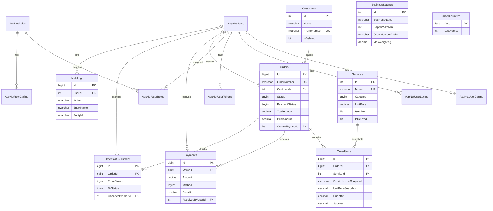

# Database Refalina Laundry

## Ringkasan desain

- Target: SQL Server 2019+ termasuk Express; LocalDB didukung untuk development.
- Skema terdiri dari 9 tabel bisnis dan 7 tabel standar ASP.NET Core Identity.
- Key Identity memakai `int`; key transaksi ber-volume tinggi (`Orders`, `OrderItems`, `Payments`, histori, audit) memakai `bigint` sesuai PRD.
- Uang memakai `decimal(18,2)`, berat/kuantitas `decimal(9,3)`, dan waktu UTC `datetime2(3)`.
- Nama serta harga layanan disimpan sebagai snapshot pada `OrderItems` agar riwayat tidak berubah.
- Nomor nota berurutan per hari dibuat atomik melalui `OrderCounters` dan `usp_GetNextOrderNumber`.
- Transaksi tidak dihapus; pembatalan memakai status `Cancelled` dan alasan wajib.
- Pendapatan dihitung dari pembayaran yang benar-benar masuk, bukan nilai order.
- Data master pelanggan dan layanan memakai soft delete.
- Login runtime, migrasi, dan backup dipisah berdasarkan least privilege.

## File dan urutan eksekusi

Jalankan dari akun administrator database pada urutan berikut:

1. `01_create_database.sql` — membuat database dan recovery model `SIMPLE`.
2. `02_create_tables.sql` — membuat tabel, PK, FK, default, dan check constraint.
3. `03_indexes.sql` — membuat indeks unik, FK, pencarian, dan laporan.
4. `04_seed.sql` — memasukkan 11 layanan, pengaturan usaha, role Owner/Cashier.
5. `05_sample_data_dev.sql` — **opsional, development saja**; 10 pelanggan dan 15 transaksi.
6. `06_procedures_and_views.sql` — procedure, tiga view, dan guard overpayment.
7. `08_security.sql` — dijalankan elevated pada Express/server; membuat login dan role minimum.
8. `99_verify.sql` — menjalankan pemeriksaan struktur, data, constraint, dan nomor nota.

`07_backup_restore.sql` adalah operasi backup ad hoc dan panduan restore, bukan migrasi. `backup.bat` digunakan oleh Windows Task Scheduler. Semua skrip setup aman dijalankan ulang; seed menggunakan key bisnis dan tidak menggandakan data.

Contoh dengan `sqlcmd` dan Windows authentication:

```bat
sqlcmd -S ".\SQLEXPRESS" -E -b -i "01_create_database.sql"
sqlcmd -S ".\SQLEXPRESS" -E -b -i "02_create_tables.sql"
sqlcmd -S ".\SQLEXPRESS" -E -b -i "03_indexes.sql"
sqlcmd -S ".\SQLEXPRESS" -E -b -i "04_seed.sql"
rem Hanya development:
sqlcmd -S ".\SQLEXPRESS" -E -b -i "05_sample_data_dev.sql"
sqlcmd -S ".\SQLEXPRESS" -E -b -i "06_procedures_and_views.sql"
sqlcmd -S ".\SQLEXPRESS" -E -b -i "08_security.sql"
sqlcmd -S ".\SQLEXPRESS" -E -b -i "99_verify.sql"
```

Opsi `-b` wajib agar pipeline berhenti saat SQL mengembalikan error. Jalankan dari folder `database` atau gunakan path absolut.

## Connection string

Development LocalDB:

```text
Server=(localdb)\MSSQLLocalDB;Database=RefalinaLaundry;Trusted_Connection=True;MultipleActiveResultSets=True;TrustServerCertificate=True
```

SQL Server Express dengan Windows authentication:

```text
Server=.\SQLEXPRESS;Database=RefalinaLaundry;Trusted_Connection=True;MultipleActiveResultSets=True;TrustServerCertificate=True
```

SQL Server pada host LAN dengan Windows authentication:

```text
Server=LAUNDRY-SERVER\SQLEXPRESS;Database=RefalinaLaundry;Integrated Security=True;Encrypt=True;TrustServerCertificate=True;MultipleActiveResultSets=True
```

Untuk SQL authentication, gunakan login `RefalinaLaundry_Runtime` dan masukkan nilai `GeneratedPassword` dari eksekusi pertama `08_security.sql` melalui environment variable/secret store saat deployment. Jangan menyimpan password di `appsettings.json` dalam repository.

## Enum yang disimpan

| Enum | Nilai database |
|---|---|
| `ServiceCategory` | `0 = PerKilo`, `1 = PerItem` |
| `OrderStatus` | `0 = Received`, `1 = InProcess`, `2 = Done`, `3 = PickedUp`, `4 = Cancelled` |
| `PaymentStatus` | `0 = Unpaid`, `1 = PartiallyPaid`, `2 = Paid` |
| `PaymentMethod` | `0 = Cash`, `1 = Transfer`, `2 = Qris` |

Seluruh nilai dibatasi `CHECK`. `CK_Orders_PaymentStatusMatchesAmounts` juga memastikan status pembayaran sesuai `PaidAmount` dan `TotalAmount`.

## ERD



## Kamus data

Semua panjang adalah karakter Unicode. Semua `datetime2(3)` bersifat UTC; konversi ke `Asia/Jakarta` dilakukan saat presentasi/laporan.

### `AspNetUsers`

| Kolom | Tipe | Keterangan |
|---|---|---|
| `Id` | `int IDENTITY` | PK pengguna Identity. |
| `UserName`, `NormalizedUserName` | `nvarchar(256) NULL` | Username dan bentuk normalisasi untuk lookup unik. |
| `Email`, `NormalizedEmail` | `nvarchar(256) NULL` | Email dan bentuk normalisasi. |
| `EmailConfirmed` | `bit NOT NULL` | Status verifikasi email. |
| `PasswordHash` | `nvarchar(max) NULL` | Hash dari `PasswordHasher`; tidak pernah diisi plain text. |
| `SecurityStamp`, `ConcurrencyStamp` | `nvarchar(max) NULL` | Stamp keamanan dan optimistic concurrency Identity. |
| `PhoneNumber` | `nvarchar(max) NULL` | Nomor telepon akun pengguna, bukan nomor pelanggan. |
| `PhoneNumberConfirmed` | `bit NOT NULL` | Status verifikasi nomor pengguna. |
| `TwoFactorEnabled` | `bit NOT NULL` | Status 2FA. |
| `LockoutEnd` | `datetimeoffset(7) NULL` | Batas waktu lockout. |
| `LockoutEnabled` | `bit NOT NULL` | Mengaktifkan lockout; aplikasi mengunci setelah lima gagal login. |
| `AccessFailedCount` | `int NOT NULL` | Jumlah gagal login, minimal nol. |
| `FullName` | `nvarchar(150) NOT NULL` | Nama lengkap tambahan dari `AppUser`. |
| `IsActive` | `bit NOT NULL` | Menonaktifkan akun tanpa menghapus referensi transaksi. |
| `MustChangePassword` | `bit NOT NULL` | Mewajibkan penggantian password awal sebelum aplikasi dapat digunakan. |

### `AspNetRoles`

| Kolom | Tipe | Keterangan |
|---|---|---|
| `Id` | `int IDENTITY` | PK role. |
| `Name` | `nvarchar(256) NULL` | Nama role (`Owner`, `Cashier`). |
| `NormalizedName` | `nvarchar(256) NULL` | Nama normalisasi unik. |
| `ConcurrencyStamp` | `nvarchar(max) NULL` | Token concurrency Identity. |

### Tabel penghubung Identity

| Tabel | Kolom dan tipe | Keterangan |
|---|---|---|
| `AspNetRoleClaims` | `Id int IDENTITY`, `RoleId int`, `ClaimType nvarchar(max)`, `ClaimValue nvarchar(max)` | Claim milik role; FK ke `AspNetRoles`. |
| `AspNetUserClaims` | `Id int IDENTITY`, `UserId int`, `ClaimType nvarchar(max)`, `ClaimValue nvarchar(max)` | Claim milik user; FK ke `AspNetUsers`. |
| `AspNetUserLogins` | `LoginProvider nvarchar(128)`, `ProviderKey nvarchar(128)`, `ProviderDisplayName nvarchar(max)`, `UserId int` | Login eksternal; PK gabungan provider/key. |
| `AspNetUserRoles` | `UserId int`, `RoleId int` | Keanggotaan user-role; PK gabungan. |
| `AspNetUserTokens` | `UserId int`, `LoginProvider nvarchar(128)`, `Name nvarchar(128)`, `Value nvarchar(max)` | Token Identity; PK gabungan tiga kolom. |

### `Customers`

| Kolom | Tipe | Keterangan |
|---|---|---|
| `Id` | `int IDENTITY` | PK pelanggan. |
| `Name` | `nvarchar(150) NOT NULL` | Nama wajib dan tidak boleh kosong. |
| `PhoneNumber` | `nvarchar(20) NULL` | Nomor unik untuk pelanggan aktif; aplikasi menormalisasi ke `62xxx`. |
| `Address` | `nvarchar(300) NULL` | Alamat pelanggan. |
| `Notes` | `nvarchar(500) NULL` | Catatan operasional. |
| `IsDeleted` | `bit NOT NULL` | Penanda soft delete. |
| `CreatedAt`, `UpdatedAt` | `datetime2(3) NOT NULL` | Waktu buat/ubah UTC. |

### `Services`

| Kolom | Tipe | Keterangan |
|---|---|---|
| `Id` | `int IDENTITY` | PK layanan. |
| `Name` | `nvarchar(100) NOT NULL` | Nama layanan unik. |
| `Category` | `tinyint NOT NULL` | `ServiceCategory`. |
| `UnitPrice` | `decimal(18,2) NOT NULL` | Harga positif per kg/per item. |
| `DurationDays` | `int NULL` | Estimasi hari nonnegatif; nilai `0` berarti selesai pada akhir hari yang sama. |
| `IsActive` | `bit NOT NULL` | Menentukan layanan dapat dipilih pada transaksi baru. |
| `IsDeleted` | `bit NOT NULL` | Soft delete master layanan. |
| `CreatedAt`, `UpdatedAt` | `datetime2(3) NOT NULL` | Waktu buat/ubah UTC. |

### `Orders`

| Kolom | Tipe | Keterangan |
|---|---|---|
| `Id` | `bigint IDENTITY` | PK transaksi. |
| `OrderNumber` | `nvarchar(30) NOT NULL` | Nomor nota unik `{Prefix}-{yyyyMMdd}-{0001}`. |
| `CustomerId` | `int NOT NULL` | FK pelanggan, `NO ACTION`. |
| `ReceivedAt` | `datetime2(3) NOT NULL` | Waktu pesanan diterima, UTC. |
| `EstimatedDoneAt` | `datetime2(3) NULL` | Estimasi selesai UTC. |
| `Status` | `tinyint NOT NULL` | `OrderStatus`. |
| `PaymentStatus` | `tinyint NOT NULL` | `PaymentStatus`, konsisten dengan jumlah bayar. |
| `TotalAmount` | `decimal(18,2) NOT NULL` | Snapshot jumlah subtotal item; positif. |
| `PaidAmount` | `decimal(18,2) NOT NULL` | Snapshot jumlah pembayaran; rentang 0 sampai total. |
| `Notes` | `nvarchar(500) NULL` | Catatan transaksi. |
| `CancelReason` | `nvarchar(300) NULL` | Wajib terisi saat status `Cancelled`. |
| `CreatedByUserId` | `int NOT NULL` | FK user pembuat. |
| `CreatedAt`, `UpdatedAt` | `datetime2(3) NOT NULL` | Waktu buat/ubah UTC. |

### `OrderItems`

| Kolom | Tipe | Keterangan |
|---|---|---|
| `Id` | `bigint IDENTITY` | PK detail. |
| `OrderId` | `bigint NOT NULL` | FK pesanan, tanpa cascade delete. |
| `ServiceId` | `int NOT NULL` | FK layanan asal. |
| `ServiceNameSnapshot` | `nvarchar(100) NOT NULL` | Nama saat transaksi dibuat. |
| `UnitPriceSnapshot` | `decimal(18,2) NOT NULL` | Harga positif saat transaksi dibuat. |
| `Quantity` | `decimal(9,3) NOT NULL` | Berat kg atau jumlah item; harus positif. |
| `Subtotal` | `decimal(18,2) NOT NULL` | Hasil quantity × snapshot harga; positif. |

### `Payments`

| Kolom | Tipe | Keterangan |
|---|---|---|
| `Id` | `bigint IDENTITY` | PK pembayaran. |
| `OrderId` | `bigint NOT NULL` | FK pesanan. |
| `Amount` | `decimal(18,2) NOT NULL` | Nilai pembayaran positif. |
| `Method` | `tinyint NOT NULL` | `PaymentMethod`. |
| `PaidAt` | `datetime2(3) NOT NULL` | Waktu pembayaran UTC. |
| `ReceivedByUserId` | `int NOT NULL` | FK kasir/penerima. |
| `Reference` | `nvarchar(100) NULL` | Referensi transfer, QRIS, atau internal. |

### `OrderStatusHistories`

| Kolom | Tipe | Keterangan |
|---|---|---|
| `Id` | `bigint IDENTITY` | PK histori. |
| `OrderId` | `bigint NOT NULL` | FK pesanan. |
| `FromStatus` | `tinyint NULL` | Status asal; `NULL` untuk histori awal. |
| `ToStatus` | `tinyint NOT NULL` | Status tujuan. |
| `ChangedByUserId` | `int NOT NULL` | FK user pengubah. |
| `ChangedAt` | `datetime2(3) NOT NULL` | Waktu perubahan UTC. |
| `Note` | `nvarchar(300) NULL` | Catatan perubahan/alasan pembatalan. |

### `AuditLogs`

| Kolom | Tipe | Keterangan |
|---|---|---|
| `Id` | `bigint IDENTITY` | PK audit. |
| `UserId` | `int NULL` | FK user; nullable untuk proses sistem. |
| `Action` | `nvarchar(50) NOT NULL` | Aksi, misalnya `OrderCancelled`, `PriceChanged`, `ReceiptReprinted`. |
| `EntityName` | `nvarchar(50) NOT NULL` | Jenis entitas. |
| `EntityId` | `nvarchar(50) NOT NULL` | ID fleksibel entitas terkait. |
| `Detail` | `nvarchar(max) NULL` | Detail audit terstruktur/teks. |
| `CreatedAt` | `datetime2(3) NOT NULL` | Waktu audit UTC. |

### `BusinessSettings`

| Kolom | Tipe | Keterangan |
|---|---|---|
| `Id` | `int IDENTITY` | PK pengaturan. MVP menggunakan baris pertama. |
| `BusinessName` | `nvarchar(150) NOT NULL` | Nama pada struk. |
| `Address` | `nvarchar(300) NOT NULL` | Alamat pada struk. |
| `PhoneNumber` | `nvarchar(20) NULL` | Nomor usaha; belum tersedia pada PRD. |
| `ReceiptFooter` | `nvarchar(500) NULL` | Footer struk. |
| `PaperWidthMm` | `int NOT NULL` | Hanya 58 atau 80 mm. |
| `OrderNumberPrefix` | `nvarchar(10) NOT NULL` | Prefix nota, seed `RL`. |
| `MaxWeightKg` | `decimal(9,3) NOT NULL` | Batas berat konfigurabel, seed 100 kg. |

### `OrderCounters`

| Kolom | Tipe | Keterangan |
|---|---|---|
| `Date` | `date` | PK tanggal bisnis. |
| `LastNumber` | `int NOT NULL` | Nomor terakhir 0–9999; diubah dengan lock serializable. |

## Procedure, view, dan integritas lintas-baris

- `usp_GetNextOrderNumber(@BusinessDate, @OrderNumber OUTPUT)` mengunci row/range counter menggunakan `UPDLOCK, HOLDLOCK`. Tanggal default adalah tanggal WIB. Panggil dalam transaksi atomik yang juga menyimpan order.
- `vw_DailyRevenue` mengelompokkan pembayaran menurut tanggal WIB dan metode.
- `vw_MonthlyRevenue` mengelompokkan pembayaran menurut bulan WIB dan metode.
- `vw_ActiveOrders` menampilkan status `Received`, `InProcess`, `Done`, sisa tagihan, dan `IsOverdue`.
- `TR_Payments_RejectOverpayment` adalah satu-satunya trigger. Constraint biasa tidak dapat menghitung agregat beberapa pembayaran, sehingga trigger hanya menolak total pembayaran di atas tagihan dan menyerialkan pembayaran bersamaan. Aplikasi tetap menghitung dan memperbarui `Orders.PaidAmount`/`PaymentStatus` dalam transaksi yang sama.

Aturan minimal satu item, kesamaan `TotalAmount = SUM(Subtotal)`, integer untuk quantity `PerItem`, maksimum berat dari `BusinessSettings`, pembulatan, dan transisi status melibatkan banyak row/configuration. Aturan tersebut tetap di domain C# dan diperiksa ulang oleh `99_verify.sql`; tidak dipindahkan menjadi trigger.

## Indeks dan pola query

- Riwayat nomor nota: seek pada `UX_Orders_OrderNumber`.
- Riwayat pelanggan: seek nama prefix melalui `IX_Customers_Name`, nomor HP melalui `UX_Customers_PhoneNumber`, lalu order melalui `IX_Orders_CustomerId`.
- Filter tanggal: `IX_Orders_ReceivedAt`; filter status: `IX_Orders_Status_PaymentStatus`.
- Detail order: covering index `IX_OrderItems_OrderId`, `IX_Payments_OrderId`, dan `IX_OrderStatusHistories_OrderId`.
- Rekap pendapatan: `IX_Payments_PaidAt` mencakup amount/method/order.

Gunakan pencarian prefix (`Name LIKE @term + '%'`) agar indeks dapat dipakai. Pencarian substring (`LIKE '%' + @term + '%'`) memerlukan scan; bila kebutuhan substring wajib pada data jauh lebih besar, evaluasi Full-Text Search secara terpisah. Target dua detik tetap harus diuji dengan volume dan perangkat production.

## Backup harian, retensi, dan restore

`backup.bat` menjalankan `BACKUP DATABASE` dengan opsi `COMPRESSION, CHECKSUM` pada Standard/Developer/Enterprise, dilanjutkan `RESTORE VERIFYONLY`, lalu menghapus file bernama `RefalinaLaundry_FULL_*.bak` yang lebih lama dari 14 hari. File lama tidak dihapus jika backup/verifikasi baru gagal.

SQL Server Express dan LocalDB terdeteksi melalui `SERVERPROPERTY('EngineEdition')` dan otomatis memakai `WITH CHECKSUM` tanpa native compression agar backup tetap berhasil. Native backup compression memang hanya tersedia pada edisi tertentu menurut [dokumentasi Microsoft tentang Backup Compression](https://learn.microsoft.com/en-us/sql/relational-databases/backup-restore/backup-compression-sql-server); ini merupakan batasan edisi, bukan pilihan skema. Content was rephrased for compliance with licensing restrictions.

Contoh konfigurasi Windows Task Scheduler untuk Express (yang tidak memiliki SQL Server Agent):

1. Buat folder, misalnya `D:\Backup\RefalinaLaundry`, dan berikan izin Modify kepada SQL Server service account serta akun scheduled task.
2. Buat task `Refalina Laundry - Full Backup`, trigger **Daily 02:00**, dan pilih **Run whether user is logged on or not**.
3. Program/script: `D:\LAUNDRY\RefalinaLaundry\database\backup.bat`.
4. Arguments: `".\SQLEXPRESS" "RefalinaLaundry" "D:\Backup\RefalinaLaundry"`.
5. Start in: `D:\LAUNDRY\RefalinaLaundry\database`.
6. Jalankan task manual sekali, periksa exit code `0`, file `.bak`, dan log Task Scheduler.
7. Salin backup secara aman ke media/host lain; backup pada disk PC yang sama tidak melindungi dari kerusakan disk.

Batch memakai `-E` (Windows integrated authentication). Administrator perlu membuat login Windows khusus task dan memasukkannya ke role backup, bukan `sysadmin`:

```sql
USE [master];
CREATE LOGIN [LAUNDRY-PC\RefalinaBackup] FROM WINDOWS;
GO
USE [RefalinaLaundry];
CREATE USER [LAUNDRY-PC\RefalinaBackup] FOR LOGIN [LAUNDRY-PC\RefalinaBackup];
ALTER ROLE [RefalinaLaundryBackupRole] ADD MEMBER [LAUNDRY-PC\RefalinaBackup];
GO
```

Sesuaikan nama mesin/akun aktual. SQL Server service account—bukan hanya user yang menjalankan `sqlcmd`—harus dapat menulis folder tujuan.

Restore:

1. Hentikan aplikasi dan ambil backup terakhir bila memungkinkan.
2. Jalankan `RESTORE HEADERONLY` dan `RESTORE FILELISTONLY` seperti contoh di `07_backup_restore.sql`.
3. Verifikasi logical file name dan tentukan path MDF/LDF tujuan.
4. Set database `SINGLE_USER`, jalankan restore dengan `CHECKSUM`, `RECOVERY`, dan `REPLACE` hanya setelah memastikan file benar.
5. Kembalikan `MULTI_USER`, jalankan `99_verify.sql`, lalu aktifkan aplikasi.
6. Uji prosedur ini berkala pada database/instance terpisah; keberadaan file backup saja belum membuktikan restore berhasil.

LocalDB cocok untuk development, bukan host production atau target scheduler. Pada Express/server, folder backup berada di sisi mesin SQL Server.

## Keamanan dan pemisahan akun

- `RefalinaLaundry_Runtime` tidak menjadi `db_owner`; memperoleh `SELECT` schema-wide, DML per tabel sesuai use case, eksekusi generator nota, dan delete hanya pada tabel anak Identity yang membutuhkan lifecycle token/claim. `OrderCounters` tidak dapat diubah langsung.
- Runtime secara eksplisit dilarang menghapus order, item, pembayaran, histori, dan audit; juga dilarang DDL, ownership, control, serta backup.
- `RefalinaLaundry_Migration` menjadi anggota `db_ddladmin`, `db_datareader`, dan `db_datawriter`; credential hanya diberikan ke proses deployment, lalu tidak dipakai aplikasi harian.
- `RefalinaLaundryBackupRole` hanya memiliki `BACKUP DATABASE`; masukkan akun Windows scheduled task ke role ini.
- Role aplikasi `Owner` dan `Cashier` tetap ditegakkan ASP.NET Core authorization. Satu login database runtime tidak dapat membedakan role pengguna akhir.
- Owner awal harus dibuat aplikasi menggunakan `UserManager<AppUser>` agar password hash, security stamp, lockout, dan role assignment benar. SQL seed sengaja tidak membuat password/hash manual.

## Keputusan dan asumsi

1. Recovery model `SIMPLE` dipilih karena MVP memakai backup penuh harian dan tidak mensyaratkan point-in-time recovery. Jika target RPO berubah, gunakan `FULL` beserta log backup terjadwal.
2. Semua waktu domain memakai `datetime2(3)` UTC. View pendapatan mengonversi ke Windows time-zone `SE Asia Standard Time` (WIB).
3. `Orders`, `OrderItems`, `Payments`, `OrderStatusHistories`, dan `AuditLogs` memakai `bigint`; tabel lain serta semua key Identity memakai `int`.
4. `Services.IsDeleted` ditambahkan karena aturan eksplisit soft delete pelanggan dan layanan, walau daftar kolom ringkas PRD hanya menyebut `IsActive`.
5. Transaksi tidak mempunyai `IsDeleted`; pembatalan direpresentasikan oleh status dan alasan, sesuai aturan transaksi tidak boleh dihapus.
6. Seed `BusinessSettings` memakai prefix `RL`, maksimum 100 kg, kertas 80 mm, alamat dari PRD, footer netral, dan telepon `NULL` karena nomor usaha belum diberikan.
7. Durasi `Kilat` adalah 0 hari (selesai pada akhir hari yang sama) sesuai keputusan final prompt aplikasi; Owner dapat mengubahnya.
8. Data development memakai nomor `08xx` sesuai permintaan data contoh. Aplikasi production tetap harus menormalisasi input pelanggan ke bentuk `62xxx` sebelum menyimpan.
9. Quantity layanan satuan disimpan `decimal(9,3)` agar satu model mendukung campuran layanan. Keutuhan bilangan bulat untuk `PerItem` divalidasi domain karena kategori tidak disalin sebagai snapshot dan `CHECK` tidak dapat membaca tabel lain.
10. Tidak ada cascade delete pada FK, termasuk Identity, agar penghapusan tidak merambat ke transaksi keuangan.
11. `AuditLogs.UserId` nullable untuk event sistem/bootstrap; event tindakan pengguna harus mengisinya.
12. `BusinessSettings` diperlakukan sebagai singleton secara aplikasi; seed memperbarui baris dengan `Id` terkecil tanpa menghapus baris lain.

## Hal yang perlu dikonfirmasi kepada klien

- Q1: merek/protokol timbangan digital.
- Q2: durasi layanan Kilat.
- Q3: printer dan lebar kertas default 58/80 mm.
- Q4: pembulatan berat dan minimum order.
- Q5: kebijakan DP/cicilan serta transfer/QRIS.
- Q6: topology deployment lokal/LAN atau online.
- Q8: jumlah akun dan akses laporan kasir.

Q4 terutama memengaruhi kesamaan subtotal. Skema menyimpan presisi tiga desimal dan tidak menerapkan pembulatan yang belum disepakati.

## Kecocokan EF Core 8

Konfigurasi EF harus menggunakan `IdentityDbContext<AppUser, IdentityRole<int>, int>` (beserta generic claim/login/token bertipe `int`) agar key cocok. Mapping tabel dan tipe mengikuti PRD, dengan catatan eksplisit berikut:

- Properti domain yang disebut `EstimatedDurationDays` pada ringkasan entitas harus dipetakan ke kolom database `Services.DurationDays`, karena bagian skema database PRD menetapkan nama `DurationDays`.
- `Services.IsDeleted` adalah tambahan wajib dari aturan soft delete.
- `AuditLogs.UserId` nullable untuk audit sistem.
- Semua `DateTime` harus ditulis sebagai UTC; EF tidak otomatis mengubah `DateTimeKind`, sehingga lakukan normalisasi pada application/infrastructure boundary.
- `TotalAmount`, `PaidAmount`, `Subtotal`, dan snapshot harga harus dikonfigurasi `decimal(18,2)`; `Quantity`/`MaxWeightKg` `decimal(9,3)`.
- Delete behavior seluruh relasi harus `DeleteBehavior.NoAction`; jangan biarkan convention Identity membuat cascade migration yang berbeda.
- Default index Identity dari template biasanya bernama `RoleNameIndex`, `UserNameIndex`, dan `EmailIndex`. Skrip ini memakai pola nama PRD (`UX_`/`IX_`); konfigurasi EF migration harus menggunakan nama yang sama agar tidak membuat indeks duplikat.

Tidak ada tabel `Users` terpisah dan tidak ada source C# yang dibuat oleh paket database ini.
